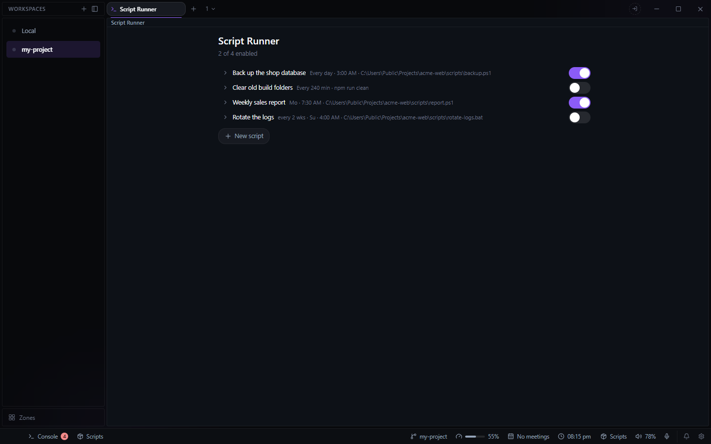

# Script Runner for Deck

Runs scripts and commands on a schedule, on this PC or on a server, and keeps what each run
printed. Open it from the **+** beside your tabs and choose **Script Runner**.

- **Schedules**: every N minutes, or at a time on the days you pick, optionally only every
  second (or Nth) week from a start date.
- **Commands**: a `.ps1`, `.bat`, `.cmd` or `.exe` (with a Browse button), or an inline
  command, with optional arguments.
- **Run now** for a job on this PC, and a switch per job to pause it without deleting it.
- **Last run** beside each job: a green or red mark that opens the run's result, exit code,
  duration and captured output.
- **Failures as notifications.** A failed run shows in Deck's notifications with its exit code
  and last line of output, whether or not the tab is open (a server job's run once the tab has
  fetched it); the notification clears when the job next succeeds.

Jobs on **This PC** are fired by Deck, so they run only while Deck is running.

## Jobs on a server

A job set to **VPS** runs on a server instead, so it fires even when this PC is off. Deck copies
those jobs to the server over SSH whenever they change, and a small systemd timer there (shipped
in the plugin's `vps/` folder) checks them once a minute. While the tab is open, Deck fetches
their runs back and lists them beside the local ones. The one-time install steps are in
Settings > Plugins > Script Runner.

Needs: the host `vps` in your `~/.ssh/config` with key-based login, and `jq` and systemd on the
server.

## Data

Kept in `data\script-runner\` in Deck's config folder: `script-runner.json` (the jobs),
`run-log.json` and `run-log-vps.json` (the runs). A backup includes the jobs and leaves out the
run logs.

## For agents

The plugin brings `deck_add_script`, `deck_set_script_enabled` and `deck_remove_script` to
Deck's MCP server. An agent can add jobs that run on this PC, every N minutes or at a time on
chosen days, and switch or remove any job by name.
